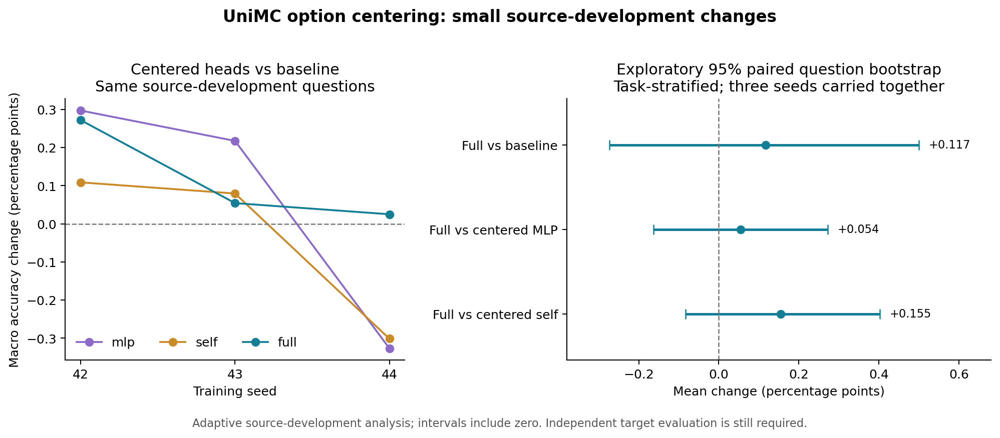
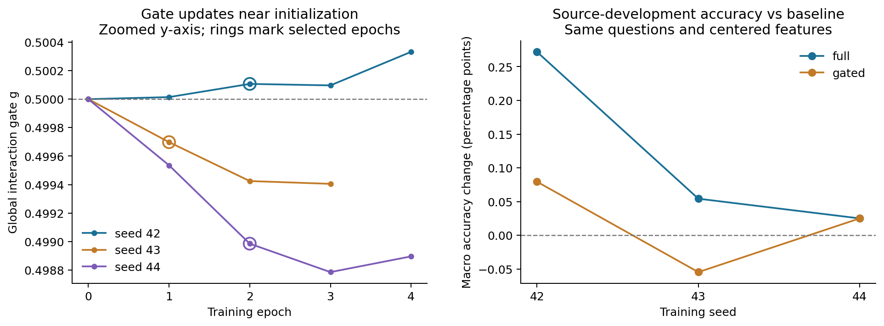

# Recorded results and evidence

## Shared evaluation scope

The pilot has PIQA and CommonsenseQA source splits:

| Task | Train | Validation | Calibration |
|---|---:|---:|---:|
| PIQA | 2,000 | 919 | 919 |
| CommonsenseQA | 2,000 | 598 | 599 |

The source train/validation/calibration pools were checked for duplicate contents and overlap. PIQA training contents overlapping the holdout pool were excluded before sampling. Calibration examples were not used to train or select these modules. The original backbone's prior exposure was not established. All model comparisons below are source-development evidence.

## Experiment sequence

| Stage | Included evidence | Finding |
|---|---|---|
| Raw 4096-state / 256-dimensional residual heads | `results/early/pilot_55518.json` | No accuracy gain in the initial single-seed pilot |
| Lower head learning rates | `results/early/tune_pilot_55518_55537.json` | Smaller settings mostly retained baseline decisions |
| Compact raw and official MLM representations | `results/early/compact_pilot_55518_55555.json` | Compact heads did not exceed the baseline in that pilot |
| Centering and matched three-seed controls | `results/heads/` | Centered full achieved a small exploratory mean gain |
| Interaction Gate | `results/gate/` | No additional mean accuracy gain over centered full |
| Native-objective LoRA, seed42 | `results/lora/training_*.json` | Best trained checkpoint was below baseline accuracy |
| FP32 component-gradient diagnostic | `results/lora/diagnostic*.json` | Option MLM mostly aligned with OP; passage MLM approximately orthogonal on average |

## Centered heads and Gate

Baseline macro accuracy is 76.4164%. Centered full has mean 76.5336% and seed SD 0.1349 percentage points across seeds 42/43/44, a +0.1172-point difference. The exploratory paired-question bootstrap interval for centered full minus baseline is approximately [−0.2734, +0.4994] points. It includes zero and does not include all uncertainty from development-set selection.

Centered MLP is 76.4792% ± 0.3394 points; centered self is 76.3788% ± 0.2288 points. The full-versus-self/MLP differences are small relative to their variation. Centering itself already uses candidate-set information.

The interaction Gate averages 76.4332% ± 0.0674 points, or +0.0168 versus baseline and −0.1004 versus centered full. Selected Gate values remained close to 0.5. Nonzero gradients and endpoint tests establish implementation behavior, not a useful learned gating policy. Slightly lower NLL does not establish calibration or rejection improvement.

## LoRA and diagnostics

The seed42 LoRA run used rank 8, alpha 16, dropout 0.05, and learning rate 1e-4. Macro accuracy was 76.1112% at the selected first epoch, versus 76.4164% baseline; the second epoch reached 75.1862%. The best adapter corrected 57 answers and harmed 61, with four fewer correct answers overall. One seed is insufficient to establish a general failure of LoRA.

The returned diagnostic contains 32 fixed training questions × three checkpoints. At the best checkpoint, OP/option-MLM mean cosine is +0.557; OP/passage-MLM mean cosine is −0.006, computed over the 20 questions with passage targets. Total MLM opposed OP in 3/32 examples. Median MLM/OP gradient norm ratios were 1.84 for PIQA and 0.43 for CommonsenseQA. Means are distorted by tiny OP denominators. These data do not establish widespread strong gradient conflict as the cause of validation decline.

The first-example BF16 precision probe differed from an explicit FP32 loss recomputation by 0.000186800956726. All 96 formal FP32 records passed strict consistency checks. This does not demonstrate a BF16-induced performance failure. See the [English report](../reports/LORA_REPORT_EN.md).

## Planned versus completed

Completed: residual-head implementations and structural pilots, centered three-seed controls, interaction Gate, one real LoRA seed, feasibility checks, and read-only loss diagnostics.

Proposed but not completed in these exports: LoRA learning rate 1e-5 versus 1e-4, passage-MLM-only ablation, multi-seed LoRA confirmation, independent-target evaluation, and calibration/no-answer rejection experiments. No new training was launched while preparing this repository.
