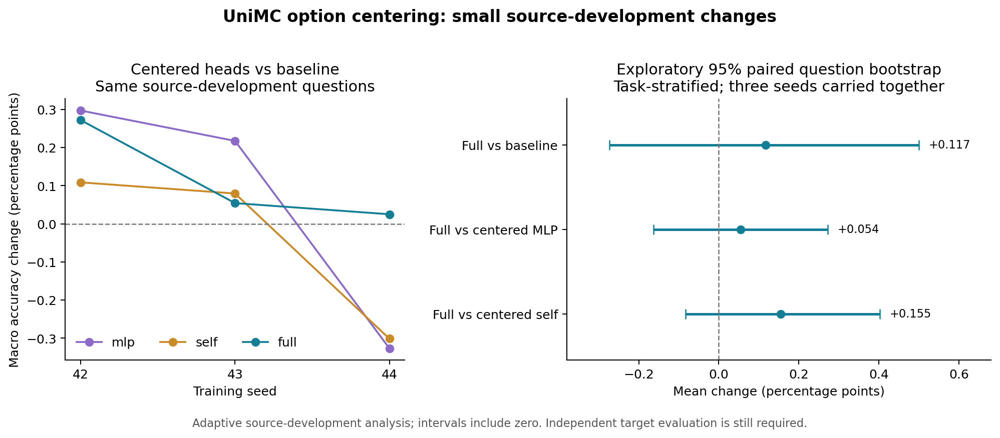

# UniMC 中心化残差评分头：源开发集复核与交付结论

主候选固定为 **官方 MLM 表示 + 题内中心化 + full 头**，保留 seed42/43/44。它在这批源开发集上的平均 Macro Accuracy 为 76.5336%，相对原版提高 0.1172 个百分点；三个种子均为正，但提升仅对应净多答对 5、1、1 道题。适合进入独立任务评估，目前不能宣称准确率显著提升。

## 数据和核对

源训练 PIQA/CQA 各 2,000 道；源验证分别 919/598，道数合计 1,517。Macro 为两个任务准确率的算术平均。共复核 18 组逐题预测，所有模型的 ID、标签、候选顺序及原版 logits 完全相同；按原始分数重新计算准确率与 NLL，与服务器导出一致。seed42 复用既有模型，43/44 为新增训练；恢复作业 55764 仅补做导出，未重训。

## 三种子结果

| 输入 / 头部 | Macro Accuracy（%） | 比原版（百分点） | Macro NLL |
|---|---:|---:|---:|
| baseline | 76.4164 | — | 0.580060 |
| uncentered / mlp | 76.3801 ± 0.0628 | -0.0363 | 0.580106 |
| uncentered / self | 76.4261 ± 0.0695 | +0.0097 | 0.580336 |
| uncentered / full | 76.4164 ± 0.0000 | +0.0000 | 0.580076 |
| centered / mlp | 76.4792 ± 0.3394 | +0.0628 | 0.579285 |
| centered / self | 76.3788 ± 0.2288 | -0.0376 | 0.579107 |
| centered / full | 76.5336 ± 0.1349 | +0.1172 | 0.579204 |

± 为三个训练种子的样本标准差，描述训练波动。未中心化 full 在三个种子均未改变任何一道题的预测。中心化让头部开始影响原版决策，但它同时可能纠正和破坏低 margin 样本。

| full 种子 | 最佳轮次 | 相对原版 Macro（百分点） | 纠正 | 破坏 | 净增加正确题 |
|---|---:|---:|---:|---:|---:|
| 42 | 1 | +0.2720 | 11 | 6 | +5 |
| 43 | 1 | +0.0544 | 10 | 9 | +1 |
| 44 | 2 | +0.0252 | 12 | 11 | +1 |

所有种子都纠正的题目 3 个，所有种子都破坏的题目 2 个，均来自 PIQA。稳定纠正例涉及眼影刷贴近皮肤、捕梦网羽毛剪裁、鱼缸滤材清洗；稳定破坏例涉及蛋糕脱模及剃须泡沫罐防锈。这里只对照数据集标签说明预测变化，不作生活操作建议。原版分数的 top-2 差值都很小，约 0.0037–0.0459。完整题文、选项、标签和逐种子预测见 `full_changed_examples.csv`，不要只展示成功案例。

## 逐题配对不确定性

centered full 相对 baseline：均值 +0.1172 个百分点，探索性 95% bootstrap 区间 **[-0.2734, +0.4994]** 个百分点，包含零。centered full 相对 centered MLP 的均值仅 +0.0544 个百分点，相对 centered self 为 +0.1548 个百分点；对应区间也包含零，尚不能证明跨选项注意力的额外准确率收益。

重采样按任务分层，以题目为配对单位，重复 20,000 次，随机种子 20261118；同题三个种子的预测整体携带。训练模型固定，不把 3×1,517 个预测当成独立题目，也不覆盖训练样本重抽或整个选模过程。开发集曾用于多轮模型探索，因此该区间是探索性分析，不能替代独立测试证据。

## 方法解释与评估范围

冻结 UniMC 的 4096 维选项表示，经过官方 MLM 的 dense、activation、LayerNorm 转为 128 维；减去同题实际候选均值，再送入 d=64、FFN=256、heads=4 的残差头，最终分数为原版 yes logit 加残差。full 头仅训练 58,689 个参数。此前诊断显示选项向量高度相似、较小头部的残差远小于原版分数间隔；中心化提高了差异信号的可用性。这是与诊断一致的解释，不能据此认定所有任务都会改善。

中心化本身使用集合信息，所以 centered self/MLP 只是不使用跨选项注意力，并非完全独立选项评分。NLL 的小幅下降也不能直接当作拒识质量提升，需由校准组及汇总实验检验。

原论文附录 A.1 将 PIQA 和 CommonsenseQA 列为 MC 训练任务，A.2 将 SST-2、CB、COPA、HellaSwag 列为评估任务。本报告属于新增头部的源开发集实验，不是目标任务零样本收益；发布基座具体训练划分是否接触这些题目尚未核实。[UniMC 原论文](https://aclanthology.org/2022.emnlp-main.474.pdf)

## 固定交接

1. 模型组交付主候选三个种子、全部 18 个对照检查点、运行脚本、配置/签名、源结果及 source_cal 原始分数，不再围绕本开发集小幅调参。
2. 校准组只在固定模型的 source_cal 上拟合/选择校准或拒识设置，不使用目标标签；需要选择超参数时，在 source_cal 内划分或交叉验证。
3. 汇总组以相同协议评估预定独立任务及候选数量/顺序变化、缺失正确答案场景；每次候选变化重新编码完整输入。保留 baseline、未中心化 full、中心化 MLP/self/full。配置和目标协议在看结果前固定。
4. 报告组区分源开发集、独立目标评估、校准和拒识指标，报告三种子和题目配对分析。主候选当前是待评估模型，不写成已验证的显著改进。

审计数据：`paired_analysis.json`；18 组逐种子表：`three_seed_results.csv`。图左显示种子差异，图右显示固定模型下的探索性题目重采样区间，两者不是同一种不确定性。
