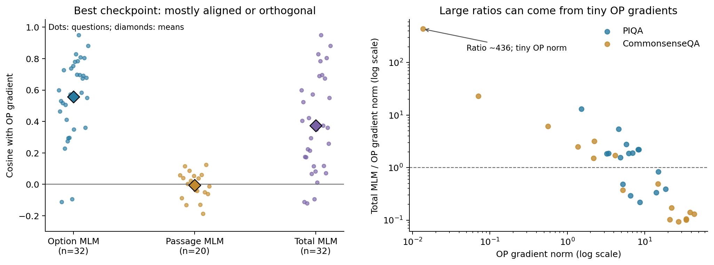

# UniMC LoRA Adaptation: Training Results and Loss–Gradient Diagnostics

**Date:** 18 November 2026  
**Scope:** Seed-42 source-task experiment and a subsequent diagnostic of its saved checkpoints

## 1. Objective and Experimental Setup

This experiment evaluated whether low-rank adaptation (LoRA) could improve UniMC's multiple-choice predictions while keeping the original model parameters frozen. The subsequent diagnostic examined whether conflicts between the classification and auxiliary language-modeling objectives could help explain the observed validation results.

LoRA was applied to the query and value projections of the English UniMC ALBERT model. Because ALBERT shares its physical layers across logical layers, the implementation adapted two physical projection modules, introducing **131,072 trainable parameters**. The configuration used rank 8, scaling parameter alpha 16, dropout 0.05, and learning rate `1e-4`. The LoRA B matrices were initialized to zero, preserving the original model's initial predictions.

Training used 4,000 source examples: 2,000 each from PIQA and CommonsenseQA. Source validation contained 919 PIQA examples and 598 CommonsenseQA examples, totaling 1,517. Macro accuracy was the equal-weight average of the two task accuracies. Training used BF16, an effective batch size of 16, a maximum of three epochs, and early-stopping patience of one epoch. Validation used FP32. The best trained checkpoint was selected by source macro accuracy, with macro negative log-likelihood (NLL) as the tie-breaker. No source-calibration or target-task data were used.

The official joint objective combined option prediction (OP) with masked language modeling (MLM). MLM supervised both the option-marker yes/no tokens, referred to here as option O-MLM, and masked passage tokens.

## 2. Training Results

| Model or checkpoint | Source macro accuracy | Change from baseline | Source macro NLL |
|---|---:|---:|---:|
| Original UniMC | 76.4164% | — | 0.580060 |
| LoRA, epoch 1: best trained checkpoint | 76.1112% | −0.3052 percentage points | 0.579807 |
| LoRA, epoch 2: final checkpoint | 75.1862% | −1.2302 percentage points | 0.575879 |

The tested configuration did not improve validation accuracy. At the best trained checkpoint, LoRA corrected 57 previously incorrect answers and changed 61 previously correct answers to incorrect ones, yielding four fewer correct answers overall. A further eight predictions switched between incorrect options.

Macro NLL decreased while accuracy declined. Thus, improvement in the probabilistic loss did not translate into better answer selection. These results come from one training seed on source development tasks; they do not establish that LoRA is generally ineffective.

## 3. Diagnostic Method and Verification

A fixed diagnostic sample contained 16 source-training examples from each task, selected with sampling seed 20261118. Each example was evaluated at three checkpoints: initial, best, and final, producing **96 diagnostic records**. Input masks were generated once and reused, and corresponding examples used the same dropout seeds across checkpoints.

The diagnostic separated OP, option O-MLM, and passage MLM. To reconstruct the original MLM reduction correctly, the two auxiliary losses were weighted by their supervised token counts:

```text
MLM = [n_option × option_O_MLM + n_passage × passage_MLM]
      / [n_option + n_passage]
Joint loss = OP + MLM
```

Gradients were calculated with respect to the LoRA parameters. Recorded quantities included component gradient norms, their cosine similarities, and the total-MLM-to-OP gradient norm ratio. The complete diagnostic forward pass and loss calculation used FP32. This was a post-hoc analysis, rather than a replay of the original BF16 training steps.

The returned configuration and three checkpoint hashes matched the archived training run. The sampled example IDs were reproduced locally, and all 96 CSV records matched their JSON counterparts. Official MLM loss and a full FP32 recomputation agreed exactly in every formal diagnostic record; the largest weighted-partition discrepancy was approximately `2.38e-7`. The server's parameter checks passed, and the diagnostic performed zero optimizer updates. Local verification checked the exported evidence and implementation; it did not rerun the full encoder.

## 4. Loss and Gradient Findings

| Checkpoint | Mean OP loss | Mean total MLM loss | Examples with negative OP–total-MLM cosine | Mean OP–option-O-MLM cosine | Mean OP–passage-MLM cosine |
|---|---:|---:|---:|---:|---:|
| Initial | 0.8926 | 0.9497 | 4/32 | +0.597 | −0.016 |
| Best, epoch 1 | 0.8336 | 0.8752 | 3/32 | +0.557 | −0.006 |
| Final, epoch 2 | 0.7946 | 0.8292 | 3/32 | +0.597 | +0.016 |

Option O-MLM gradients were generally aligned with OP. At the best checkpoint, only two of the 32 examples had a negative OP–option-O-MLM cosine. Passage MLM was more weakly associated with OP: its mean cosine was close to zero. Passage comparisons included only the 20 examples with passage supervision; the remaining 12 had zero passage gradients. Nine of those 20 examples had negative passage-related cosine values at the best checkpoint.

The sample therefore provides little support for a broad, consistently opposing relationship between the joint auxiliary objective and classification. It also does not demonstrate that passage MLM improves classification. These are averages of per-example cosines, rather than the cosine between aggregated batch gradients, and cannot characterize the entire training trajectory.

The relative gradient magnitudes differed between tasks:

| Checkpoint | PIQA: median MLM/OP gradient norm ratio | CommonsenseQA: median ratio |
|---|---:|---:|
| Initial | 0.92 | 0.44 |
| Best, epoch 1 | 1.84 | 0.43 |
| Final, epoch 2 | 1.60 | 0.43 |

For a typical sampled PIQA example at the best checkpoint, the auxiliary gradient was larger than the classification gradient. The opposite pattern held for the median CommonsenseQA example. Arithmetic means were distorted by examples with very small OP gradients: one CommonsenseQA example had a ratio of approximately 436 at the best checkpoint, despite the task median being only 0.43. Gradient norm ratios also do not directly measure AdamW parameter updates, which depend on accumulation, clipping, and optimizer state.

Both diagnostic losses decreased across checkpoints, alongside the previously observed decline in validation accuracy. This shows that better fit to the sampled training objectives did not deliver better validation decisions. It does not establish a specific cause, such as harmful passage supervision, an excessive learning rate, or overfitting.



*Left: per-example cosine similarities, with diamonds marking means. Right: gradient norm ratios plotted against OP gradient norms; a small denominator explains an extreme ratio.*

## 5. Numerical Precision Check

An additional first-example probe compared the original BF16 path with explicit FP32 loss recomputation. The BF16 path returned a float32 official MLM loss of `1.123046875`; recomputation from the same logits gave `1.123233675956726`, an absolute difference of **0.000186800956726**. With a complete FP32 forward pass, both values were `1.1213107109069824`.

The original discrepancy exceeded the diagnostic assertion tolerance. The revised diagnostic retained strict verification and standardized the formal analysis to FP32. This single-example, no-gradient probe does not establish that BF16 caused the validation accuracy decline.

## 6. Recommended Follow-up

The next experiment should isolate the learning rate: reduce it from **`1e-4` to `1e-5`**, while retaining the official joint objective, seed 42, data split, adapter configuration, precision settings, effective batch size, maximum epoch budget, early-stopping rule, and checkpoint-selection criterion. Training should restart with zero-initialized B matrices rather than continue from a trained adapter. This comparison would test sensitivity to step size without assuming that a smaller learning rate will improve accuracy.

If a later experiment examines auxiliary losses, passage MLM should be ablated separately while retaining option O-MLM. Matched runs should preserve input masks, initialization, sample order, learning rate, and training budget. The original option-loss token weight should also be retained when removing the passage term, avoiding a simultaneous change in option-loss scaling. Any change to the loss precision implementation requires a matching joint-objective control.

Any promising source-development result should subsequently be checked across multiple training seeds and independent target tasks using fixed settings. The current diagnostic has identified useful experimental distinctions, but has not established an accuracy improvement or a definitive cause of the observed decline. No new training run was launched as part of this diagnostic review.

## Evidence Files

- [Training summary](../results/lora/training_summary.json)
- [Training history](../results/lora/training_history.json)
- [Full diagnostic records](../results/lora/diagnostic.json)
- [Verification and derived statistics](../results/lora/diagnostic_audit.json)
