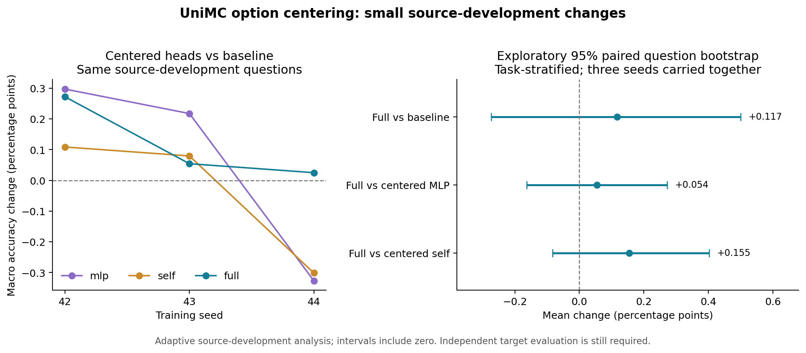
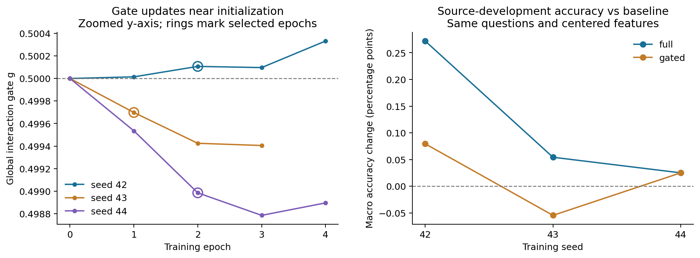
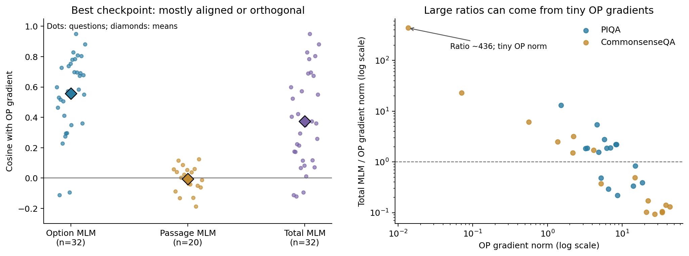

# Model Optimization Technical Report

This report combines the method description, complete source-development results,
and the detailed English LoRA training/diagnostic report. Numerical result exports
remain in `../results/`; their values and the implementation signatures are unchanged.

## Methods

### Official encoding and baseline

Use the official custom UniMC dataset encoder, tokenizer, position IDs, and attention masks. A complete question contains its candidates in the official structured input; it is not equivalent to independently invoking an ordinary encoder on each candidate. The baseline score is the original yes-token logit at each option marker. Pretrained exposure to the pilot tasks was not established; source-split disjointness concerns training the new modules.

### Frozen-backbone scoring heads

`extract_features.py` stores each option-marker state and its original score while the backbone is in evaluation mode. Raw states have dimension 4096. `decision_head.py` implements MLP, self-only attention, and full option attention without option-position embeddings. The correction head is zero-initialized, and final scores equal baseline scores plus the learned correction. Masks exclude padded options; tests cover permutation equivariance, finite gradients, and all-padding rejection.

The original raw-state model used a 256-dimensional projection. Later compact models use dimension 64. `project_mlm_features.py` applies the original frozen MLM dense/activation/LayerNorm transformation to produce 128-dimensional predecoder states. It preserves the original baseline scores rather than approximating them from cached states.

### Option centering and controls

For question q with K actual candidates, `center_option_features.py` subtracts the mean of the K candidate vectors from every vector. Padding is excluded, and labels are not used. The centered representation is saved as FP32.

Centering introduces candidate-set dependence even for MLP and self-only heads. Therefore, centered full versus centered self/MLP measures the incremental role of cross-option attention under a common set-based representation. Uncentered controls are retained separately. Three-seed studies use seeds 42, 43, and 44, common inputs, and matched initialization where required.

### Interaction Gate

`interaction_gate_head.py` computes self-only and full attention from shared parameters and interpolates their attention outputs:

```text
m = m_self + sigmoid(alpha) * (m_full - m_self)
```

The learned global scalar starts at 0.5 and adds one trainable parameter. With a nonzero scorer, Gate endpoints are checked against the self/full architectures. This differs from the older `train_head.py --gate` flag, which scales the entire correction. The real interaction-Gate experiment used centered MLM features and a 64-dimensional head, not the initial 256-dimensional architecture.

### LoRA adaptation

`unimc_lora.py` adds `(alpha/r) * B * A * dropout(x)` to frozen query/value projections. Only A/B are trainable; B starts at zero. ALBERT's logical layers reuse physical modules, so adapters are injected once per physical projection. For the recorded base, rank 8 yields two modules and 131,072 parameters. Non-reentrant gradient checkpointing supports frozen input embeddings.

`unimc_online.py` reuses official online encoding and loss computation. It deep-copies choices before the upstream encoder can shorten them and corrects padding MLM targets to −100. The native objective is OP plus token-averaged MLM, comprising option-marker yes/no supervision and passage supervision. This differs from training residual heads only on frozen cached states.

`run_unimc_lora.py` performs a real feasibility check before training, verifies zero-adapter baseline parity, and saves adapters separately from the base. Prediction requires the exact backbone/encoding and implementation signatures. No current LoRA result is combined with the centered residual head.

### Read-only loss diagnostics

`diagnose_unimc_lora.py` fixes 16 source-training questions per task and compares initial, best, and final adapters on identical sampled masks and dropout seeds. The formal diagnostic is FP32 and has zero optimizer steps. Option and passage MLM averages are weighted by their target counts to reconstruct the original MLM reduction. Component gradients are measured only with respect to A/B. Per-example cosine averages are not aggregate-batch cosine measurements.

### Selection and downstream boundary

Head training uses source training/validation only, with macro accuracy for selection and NLL as tie-breaker. Source calibration remains separate. The handoff tools export uncalibrated scores for downstream calibration; they do not fit calibration or rejection models. No independent-target evaluation result is included in this repository.

## Source development results

### Shared evaluation scope

The pilot has PIQA and CommonsenseQA source splits:

| Task | Train | Validation | Calibration |
|---|---:|---:|---:|
| PIQA | 2,000 | 919 | 919 |
| CommonsenseQA | 2,000 | 598 | 599 |

The source train/validation/calibration pools were checked for duplicate contents and overlap. PIQA training contents overlapping the holdout pool were excluded before sampling. Calibration examples were not used to train or select these modules. The original backbone's prior exposure was not established. All model comparisons below are source-development evidence.

### Experiment sequence

| Stage | Included evidence | Finding |
|---|---|---|
| Raw 4096-state / 256-dimensional residual heads | `results/early/pilot_55518.json` | No accuracy gain in the initial single-seed pilot |
| Lower head learning rates | `results/early/tune_pilot_55518_55537.json` | Smaller settings mostly retained baseline decisions |
| Compact raw and official MLM representations | `results/early/compact_pilot_55518_55555.json` | Compact heads did not exceed the baseline in that pilot |
| Centering and matched three-seed controls | `results/heads/` | Centered full achieved a small exploratory mean gain |
| Interaction Gate | `results/gate/` | No additional mean accuracy gain over centered full |
| Native-objective LoRA, seed42 | `results/lora/training_*.json` | Best trained checkpoint was below baseline accuracy |
| FP32 component-gradient diagnostic | `results/lora/diagnostic*.json` | Option MLM mostly aligned with OP; passage MLM approximately orthogonal on average |

### Centered heads and Gate

Baseline macro accuracy is 76.4164%. Centered full has mean 76.5336% and seed SD 0.1349 percentage points across seeds 42/43/44, a +0.1172-point difference. The exploratory paired-question bootstrap interval for centered full minus baseline is approximately [−0.2734, +0.4994] points. It includes zero and does not include all uncertainty from development-set selection.

Centered MLP is 76.4792% ± 0.3394 points; centered self is 76.3788% ± 0.2288 points. The full-versus-self/MLP differences are small relative to their variation. Centering itself already uses candidate-set information.

The interaction Gate averages 76.4332% ± 0.0674 points, or +0.0168 versus baseline and −0.1004 versus centered full. Selected Gate values remained close to 0.5. Nonzero gradients and endpoint tests establish implementation behavior, not a useful learned gating policy. Slightly lower NLL does not establish calibration or rejection improvement.






### Planned versus completed

Completed: residual-head implementations and structural pilots, centered three-seed controls, interaction Gate, one real LoRA seed, feasibility checks, and read-only loss diagnostics.

Proposed but not completed in these exports: LoRA learning rate 1e-5 versus 1e-4, passage-MLM-only ablation, multi-seed LoRA confirmation, independent-target evaluation, and calibration/no-answer rejection experiments. No new training was launched while preparing this repository.

## LoRA training and component diagnostics

**Date:** 18 November 2026  
**Scope:** Seed-42 source-task experiment and a subsequent diagnostic of its saved checkpoints

### 1. Objective and Experimental Setup

This experiment evaluated whether low-rank adaptation (LoRA) could improve UniMC's multiple-choice predictions while keeping the original model parameters frozen. The subsequent diagnostic examined whether conflicts between the classification and auxiliary language-modeling objectives could help explain the observed validation results.

LoRA was applied to the query and value projections of the English UniMC ALBERT model. Because ALBERT shares its physical layers across logical layers, the implementation adapted two physical projection modules, introducing **131,072 trainable parameters**. The configuration used rank 8, scaling parameter alpha 16, dropout 0.05, and learning rate `1e-4`. The LoRA B matrices were initialized to zero, preserving the original model's initial predictions.

Training used 4,000 source examples: 2,000 each from PIQA and CommonsenseQA. Source validation contained 919 PIQA examples and 598 CommonsenseQA examples, totaling 1,517. Macro accuracy was the equal-weight average of the two task accuracies. Training used BF16, an effective batch size of 16, a maximum of three epochs, and early-stopping patience of one epoch. Validation used FP32. The best trained checkpoint was selected by source macro accuracy, with macro negative log-likelihood (NLL) as the tie-breaker. No source-calibration or target-task data were used.

The official joint objective combined option prediction (OP) with masked language modeling (MLM). MLM supervised both the option-marker yes/no tokens, referred to here as option O-MLM, and masked passage tokens.

### 2. Training Results

| Model or checkpoint | Source macro accuracy | Change from baseline | Source macro NLL |
|---|---:|---:|---:|
| Original UniMC | 76.4164% | — | 0.580060 |
| LoRA, epoch 1: best trained checkpoint | 76.1112% | −0.3052 percentage points | 0.579807 |
| LoRA, epoch 2: final checkpoint | 75.1862% | −1.2302 percentage points | 0.575879 |

The tested configuration did not improve validation accuracy. At the best trained checkpoint, LoRA corrected 57 previously incorrect answers and changed 61 previously correct answers to incorrect ones, yielding four fewer correct answers overall. A further eight predictions switched between incorrect options.

Macro NLL decreased while accuracy declined. Thus, improvement in the probabilistic loss did not translate into better answer selection. These results come from one training seed on source development tasks; they do not establish that LoRA is generally ineffective.

### 3. Diagnostic Method and Verification

A fixed diagnostic sample contained 16 source-training examples from each task, selected with sampling seed 20261118. Each example was evaluated at three checkpoints: initial, best, and final, producing **96 diagnostic records**. Input masks were generated once and reused, and corresponding examples used the same dropout seeds across checkpoints.

The diagnostic separated OP, option O-MLM, and passage MLM. To reconstruct the original MLM reduction correctly, the two auxiliary losses were weighted by their supervised token counts:

```text
MLM = [n_option × option_O_MLM + n_passage × passage_MLM]
      / [n_option + n_passage]
Joint loss = OP + MLM
```

Gradients were calculated with respect to the LoRA parameters. Recorded quantities included component gradient norms, their cosine similarities, and the total-MLM-to-OP gradient norm ratio. The complete diagnostic forward pass and loss calculation used FP32. This was a post-hoc analysis, rather than a replay of the original BF16 training steps.

The returned configuration and three checkpoint hashes matched the archived training run. The sampled example IDs were reproduced locally, and all 96 CSV records matched their JSON counterparts. Official MLM loss and a full FP32 recomputation agreed exactly in every formal diagnostic record; the largest weighted-partition discrepancy was approximately `2.38e-7`. The server's parameter checks passed, and the diagnostic performed zero optimizer updates. Local verification checked the exported evidence and implementation; it did not rerun the full encoder.

### 4. Loss and Gradient Findings

| Checkpoint | Mean OP loss | Mean total MLM loss | Examples with negative OP–total-MLM cosine | Mean OP–option-O-MLM cosine | Mean OP–passage-MLM cosine |
|---|---:|---:|---:|---:|---:|
| Initial | 0.8926 | 0.9497 | 4/32 | +0.597 | −0.016 |
| Best, epoch 1 | 0.8336 | 0.8752 | 3/32 | +0.557 | −0.006 |
| Final, epoch 2 | 0.7946 | 0.8292 | 3/32 | +0.597 | +0.016 |

Option O-MLM gradients were generally aligned with OP. At the best checkpoint, only two of the 32 examples had a negative OP–option-O-MLM cosine. Passage MLM was more weakly associated with OP: its mean cosine was close to zero. Passage comparisons included only the 20 examples with passage supervision; the remaining 12 had zero passage gradients. Nine of those 20 examples had negative passage-related cosine values at the best checkpoint.

The sample therefore provides little support for a broad, consistently opposing relationship between the joint auxiliary objective and classification. It also does not demonstrate that passage MLM improves classification. These are averages of per-example cosines, rather than the cosine between aggregated batch gradients, and cannot characterize the entire training trajectory.

The relative gradient magnitudes differed between tasks:

| Checkpoint | PIQA: median MLM/OP gradient norm ratio | CommonsenseQA: median ratio |
|---|---:|---:|
| Initial | 0.92 | 0.44 |
| Best, epoch 1 | 1.84 | 0.43 |
| Final, epoch 2 | 1.60 | 0.43 |

For a typical sampled PIQA example at the best checkpoint, the auxiliary gradient was larger than the classification gradient. The opposite pattern held for the median CommonsenseQA example. Arithmetic means were distorted by examples with very small OP gradients: one CommonsenseQA example had a ratio of approximately 436 at the best checkpoint, despite the task median being only 0.43. Gradient norm ratios also do not directly measure AdamW parameter updates, which depend on accumulation, clipping, and optimizer state.

Both diagnostic losses decreased across checkpoints, alongside the previously observed decline in validation accuracy. This shows that better fit to the sampled training objectives did not deliver better validation decisions. It does not establish a specific cause, such as harmful passage supervision, an excessive learning rate, or overfitting.



*Left: per-example cosine similarities, with diamonds marking means. Right: gradient norm ratios plotted against OP gradient norms; a small denominator explains an extreme ratio.*

### 5. Numerical Precision Check

An additional first-example probe compared the original BF16 path with explicit FP32 loss recomputation. The BF16 path returned a float32 official MLM loss of `1.123046875`; recomputation from the same logits gave `1.123233675956726`, an absolute difference of **0.000186800956726**. With a complete FP32 forward pass, both values were `1.1213107109069824`.

The original discrepancy exceeded the diagnostic assertion tolerance. The revised diagnostic retained strict verification and standardized the formal analysis to FP32. This single-example, no-gradient probe does not establish that BF16 caused the validation accuracy decline.

### 6. Recommended Follow-up

The next experiment should isolate the learning rate: reduce it from **`1e-4` to `1e-5`**, while retaining the official joint objective, seed 42, data split, adapter configuration, precision settings, effective batch size, maximum epoch budget, early-stopping rule, and checkpoint-selection criterion. Training should restart with zero-initialized B matrices rather than continue from a trained adapter. This comparison would test sensitivity to step size without assuming that a smaller learning rate will improve accuracy.

If a later experiment examines auxiliary losses, passage MLM should be ablated separately while retaining option O-MLM. Matched runs should preserve input masks, initialization, sample order, learning rate, and training budget. The original option-loss token weight should also be retained when removing the passage term, avoiding a simultaneous change in option-loss scaling. Any change to the loss precision implementation requires a matching joint-objective control.

Any promising source-development result should subsequently be checked across multiple training seeds and independent target tasks using fixed settings. The current diagnostic has identified useful experimental distinctions, but has not established an accuracy improvement or a definitive cause of the observed decline. No new training run was launched as part of this diagnostic review.

### Evidence Files

- [Training summary](../results/lora/training_summary.json)
- [Training history](../results/lora/training_history.json)
- [Full diagnostic records](../results/lora/diagnostic.json)
- [Verification and derived statistics](../results/lora/diagnostic_audit.json)
